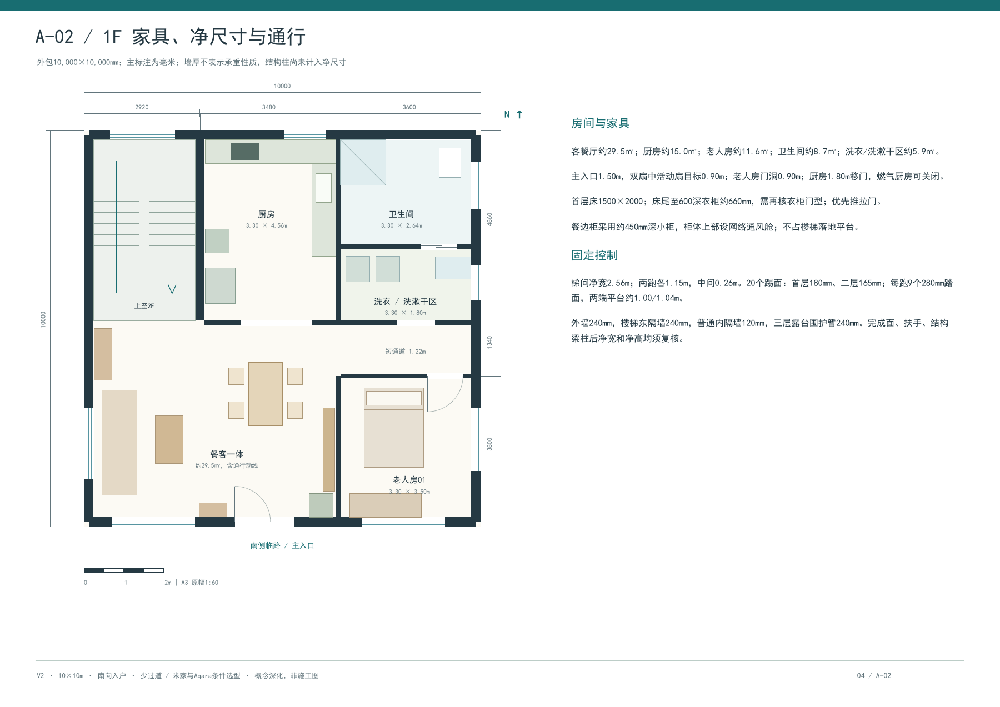
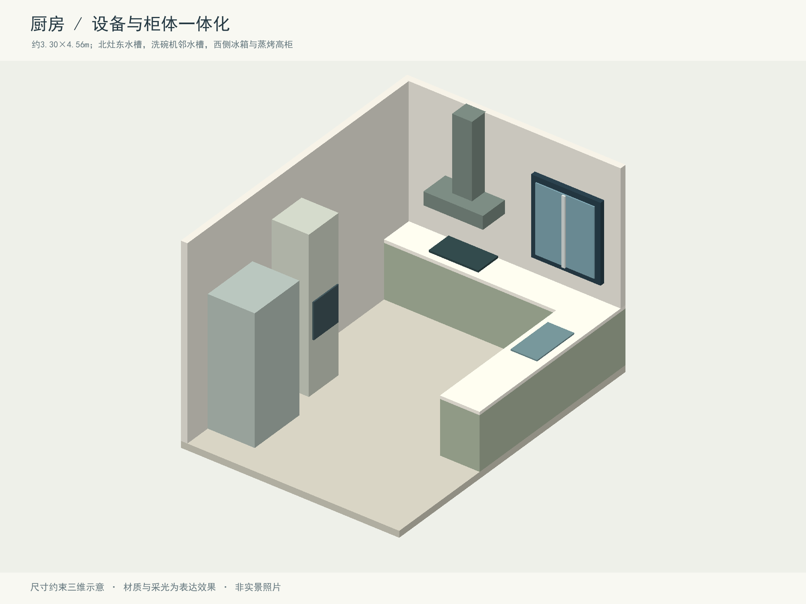

# 南院 · 三层农村住宅与全屋智能设计

10 × 10 米、三层、南向入户的农村自建房概念设计项目，包含建筑布局、装修示意、水电网气路线和智能家居设备安装点位。

## 当前版本：V2

- 西北楼梯连接公共厅，减少独立过道；另附东西镜像方案。
- 暂按 5 间卧室、书房、三层西南露台配置。
- 首层餐客厅约 29.5 平方米，包含通行面积。
- 39 页 A3 图册，130 条计划设备、控制和预留点位。
- 米家为主要使用入口，Aqara 按具体型号、地区、网关和功能核对兼容性。
- 包含家电、灯光、窗帘、网络、传感器、柜体安装立面以及本地/人工操作策略。

## 浏览文件

| 内容 | 文件 |
| --- | --- |
| V2 完整 PDF | [39 页方案图册](output/house_design_v2/10x10三层住宅_V2少过道与全屋智能.pdf) |
| V2 浏览入口 | [index.html](output/house_design_v2/index.html) |
| 可搜索硬件安装表 | [设备点位表.html](output/house_design_v2/设备点位表.html) |
| 全部设备数据 | [device_points.json](output/house_design_v2/device_points.json) |
| 高清单页图纸 | [pages](output/house_design_v2/pages) |
| 三维建模示意 | [images](output/house_design_v2/images) |
| 初版档案 | [V1 说明](output/house_design/README.md) |

GitHub/Gitee 仓库页面通常只显示 HTML 源码。克隆或下载项目后，直接用浏览器打开 V2 的 `index.html`，即可离线浏览全部图纸和可搜索点位表。本项目未启用公开网站托管。





## 生成图册

推荐 Python 3.12 或更新版本，以及 Node.js（仅历史环境使用，V2 生成无需 Node.js）。

```powershell
python -m pip install -r requirements.txt
python output/house_design_v2/build_v2.py
pdftoppm -scale-to 1800 -png "output/house_design_v2/10x10三层住宅_V2少过道与全屋智能.pdf" "output/house_design_v2/pages/sheet"
python output/house_design_v2/package_v2.py
```

需要另行安装 Poppler，使 `pdftoppm` 可用。当前绘图脚本使用 Windows 字体 `C:/Windows/Fonts/simhei.ttf`；在其他系统上需修改 `drawing_backend.py` 和 `package_v2.py` 中的字体路径为支持中文的字体。

PDF、页面 PNG、HTML、点位 JSON 和绘图源码均随仓库保存；临时质量检查图片、Python 缓存和重复内容的 ZIP 打包文件不提交。执行打包脚本可以重新生成 ZIP。

## 设计范围

已确认条件：10×10 米、三层、南侧临路及入户、米家/Aqara 智能方向。实际常住人数、所在地、预算、气源与设备型号尚待确认；分体空调、空气源热泵热水及家电规格均为当前方案假设。

本项目是概念深化与专业沟通材料，不是可直接施工的图纸。结构基础、配筋、净空、消防、节能、最终机电计算、燃气接入和设备安装条件需由当地专业团队完成。130 条点位包含备用及控制点，不代表采购 130 台设备。

效果图为本地三维几何建模示意，非实景照片或写实效果承诺。V1 和 V2 的位置不同，不要混用两个版本的图纸。
